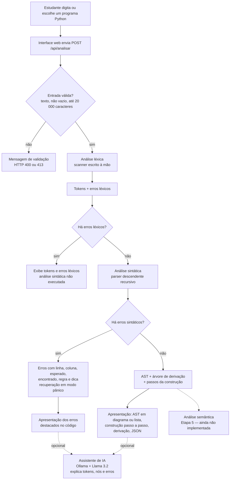

# Registros para o artigo — Materiais e Métodos (Etapa 4)

Material de apoio para a seção de Materiais e Métodos. Descreve o que foi
**efetivamente implementado** até a Etapa 4. Comparações com a literatura devem
citar apenas os artigos realmente lidos (seção 5).

## 1. Fluxograma do sistema

O GitHub desenha o diagrama abaixo automaticamente (Mermaid). Para o artigo,
ele pode ser exportado como imagem em https://mermaid.live.

## 2. Materiais (tecnologias)

| Componente            | Tecnologia                                      | Papel |
|-----------------------|-------------------------------------------------|-------|
| Interface             | HTML, CSS e JavaScript, sem frameworks          | entrada do código e visualizações |
| Servidor web          | Nginx (imagem `nginx:alpine`)                   | arquivos estáticos e repasse de `/api/` ao backend |
| Backend               | Python 3.11 + Flask 3.1                         | validação, scanner, parser e API |
| Analisador léxico     | Python, escrito à mão (Etapa 3)                 | tokens com linha e coluna |
| Analisador sintático  | Python, descendente recursivo, escrito à mão    | gramática EBNF, AST, derivação, erros |
| Assistente de IA (opcional) | Ollama + Llama 3.2 (3B)                   | explicações em linguagem natural |
| Infraestrutura        | Docker e Docker Compose                          | ambiente reproduzível |
| Testes                | unittest (Python), Node.js Test Runner, Playwright (Chromium) | testes unitários, de API e de interface |

## 3. Métodos: decisões técnicas da Etapa 4

1. **Gramática explícita em EBNF** (30 regras; `docs/GRAMATICA.md`), coerente com
   os tokens da Etapa 3. Não foi preciso alterar o scanner.
2. **Precedência codificada na gramática** (uma regra por nível), sem recursão à
   esquerda. A associatividade à esquerda é obtida com repetição, e a de `**`, à
   direita, com recursão à direita.
3. **Parser descendente recursivo escrito à mão**: um método por não terminal.
   Escolhido pela correspondência direta entre gramática e código, que tem valor
   didático, e pelo controle sobre as mensagens de erro. Geradores (ANTLR, Lark,
   PLY) e o módulo `ast` do Python foram considerados e descartados.
4. **Fatoração à esquerda** para separar atribuição e comando de expressão sem
   retrocesso.
5. **AST com formato uniforme** em JSON: tipo, categoria, regra, papel,
   atributos, posição inicial e final, filhos (`docs/AST.md`).
6. **Árvore de derivação e passos da construção** registrados durante o
   reconhecimento, para comparar AST e derivação e animar a construção.
7. **Parser não executado quando há erros léxicos**, para evitar diagnósticos
   enganosos.
8. **Recuperação de erros em modo pânico**: sincronização no fim da linha,
   descartando o bloco indentado seguinte para evitar erros em cascata.
9. **Mensagens didáticas** com o que foi encontrado, o que era esperado e a regra
   gramatical violada (produção EBNF), além de uma dica de correção.
10. **Visualização**: AST em diagrama ou em lista navegável, com cores e
    **formas** por categoria, para não depender só de cor. Selecionar um nó
    destaca o trecho do código, a regra da gramática e os tokens do nó; há filtro
    por tipo, exportação em JSON e versão para celular.
11. **IA como complemento, não como analisador**: o backend recalcula a análise
    e envia ao modelo apenas os resultados reais do compilador, marcados como
    dados.

## 4. Critérios de avaliação e casos de teste (definidos antes dos resultados)

### 4.1 Critérios

| Critério | Como medir | Meta |
|----------|------------|------|
| Correção do reconhecimento | programas válidos aceitos / total de programas válidos testados | 100% |
| Detecção de erros | programas inválidos rejeitados / total de inválidos testados | 100% |
| Precedência e associatividade | árvores iguais à referência nos casos `2+3*4`, `10-3-2`, `(10+5)*2`, `2**3**2`, `-2**2` | 100% |
| Localização dos erros | erros com linha e coluna iguais às esperadas | 100% |
| Qualidade da mensagem | a mensagem informa o encontrado, o esperado e a regra (verificado nos campos `encontrado`, `esperado`, `regra`) | 100% |
| Ausência de cascata | um erro de cabeçalho (`if` sem `:`) gera exatamente um erro | 100% |
| Consistência entre visualizações | tokens consumidos pelo parser = tokens do scanner; posições dos nós = posições dos tokens | 100% |
| Robustez | entradas vazias, só comentários, muito grandes ou muito aninhadas não derrubam o sistema | 100% |
| Regressão | todos os testes das Etapas 2 e 3 continuam passando | 100% |

### 4.2 Casos de teste

Os casos estão automatizados em `backend/test_parser.py` (68 testes),
`backend/test_app.py`, `frontend/test_interface.js` e `tests/test_interface.py`.
Resumo:

- **Válidos:** atribuições simples e compostas, atribuição a item de lista,
  literais de todos os tipos, listas, chamadas, indexação, atributos,
  `if/elif/else`, `while`, `for`, `def` com e sem parâmetros, `return` com e sem
  valor, `pass/break/continue`, blocos na mesma linha, `;`, construções
  aninhadas em quatro níveis, quebra de linha dentro de parênteses.
- **Construções incompletas:** `x = 5 +`, `if x > 1` sem `:`, `print(1 2)`,
  `x = v[1 2]`, `if x:` no fim do código, `for i in`, bloco sem indentação.
- **Combinações inválidas:** `else`/`elif` sem `if`, operadores consecutivos,
  palavra reservada como nome (`def if`, `for while in`), dois valores sem
  operador, atribuição a literal, a `True` ou a chamada, indentação inesperada,
  comando composto depois de `;`, construções fora do subconjunto (`class`,
  `import`, `lambda`, comparação e atribuição encadeadas, parâmetro com valor
  padrão).
- **Bordas:** código vazio, só comentários, comando único, código grande (4400
  tokens), 200 níveis de parênteses.

Os resultados obtidos estão em `docs/RELATORIO_TESTES.md`.

## 5. Comparação com a literatura (a preencher com os artigos pesquisados)

Para cada artigo ou ferramenta estudada, registre se ela oferece o recurso. Não
afirme novidade sem base: se um recurso não aparece em nenhum dos artigos lidos,
escreva que **não foi encontrado nos trabalhos analisados**, não que é inédito.

| Recurso | Este sistema | Artigo/ferramenta 1 | Artigo/ferramenta 2 | ... |
|---------|:------------:|:-------------------:|:-------------------:|:---:|
| Gramática formal publicada (EBNF) com explicação | sim | | | |
| Linguagem: subconjunto de Python com indentação significativa (INDENTA/DEDENTA) | sim | | | |
| Tabela de tokens com linha e coluna | sim | | | |
| Animação passo a passo da análise léxica | sim | | | |
| AST visual (diagrama) | sim | | | |
| AST navegável (expandir/recolher) | sim | | | |
| Seleção de nó destaca o trecho do código | sim | | | |
| Construção da árvore animada passo a passo (pilha de regras) | sim | | | |
| Árvore de derivação e AST lado a lado, com explicação da diferença | sim | | | |
| Mensagens de erro que citam a regra gramatical violada | sim | | | |
| Recuperação de erros (vários erros de uma vez) | sim | | | |
| Exportação da AST (JSON) | sim | | | |
| Explicações por IA ligadas ao token, nó ou erro selecionado | sim (opcional) | | | |
| Tutorial para estudantes | sim | | | |
| Uso no celular | sim | | | |
| Execução local com Docker | sim | | | |
| Testes automatizados publicados | sim | | | |
