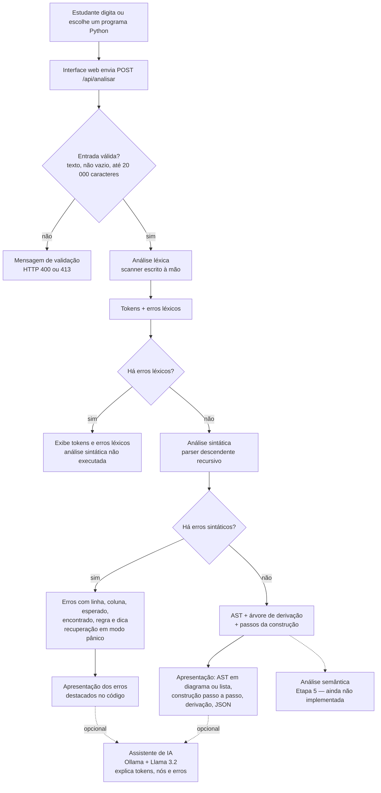

# Registros para o artigo — Materiais e Métodos (Etapa 4)

Material de apoio para a seção de Materiais e Métodos. Descreve o que foi
**efetivamente implementado** até a Etapa 4. Comparações com a literatura devem
citar apenas os artigos realmente lidos (seção 5).

## 1. Fluxograma do sistema

O GitHub desenha o diagrama abaixo automaticamente (Mermaid). Para o artigo,
ele pode ser exportado como imagem em https://mermaid.live.

## 2. Materiais (tecnologias)

| Componente            | Tecnologia                                      | Papel |
|-----------------------|-------------------------------------------------|-------|
| Interface             | HTML, CSS e JavaScript, sem frameworks          | entrada do código e visualizações |
| Servidor web          | Nginx (imagem `nginx:alpine`)                   | arquivos estáticos e repasse de `/api/` ao backend |
| Backend               | Python 3.11 + Flask 3.1                         | validação, scanner, parser e API |
| Analisador léxico     | Python, escrito à mão (Etapa 3)                 | tokens com linha e coluna |
| Analisador sintático  | Python, descendente recursivo, escrito à mão    | gramática EBNF, AST, derivação, erros |
| Assistente de IA (opcional) | Ollama + Llama 3.2 (3B)                   | explicações em linguagem natural |
| Infraestrutura        | Docker e Docker Compose                          | ambiente reproduzível |
| Testes                | unittest (Python), Node.js Test Runner, Playwright (Chromium) | testes unitários, de API e de interface |

## 3. Métodos: decisões técnicas da Etapa 4

1. **Gramática explícita em EBNF** (30 regras; `docs/GRAMATICA.md`), coerente com
   os tokens da Etapa 3. Não foi preciso alterar o scanner.
2. **Precedência codificada na gramática** (uma regra por nível), sem recursão à
   esquerda. A associatividade à esquerda é obtida com repetição, e a de `**`, à
   direita, com recursão à direita.
3. **Parser descendente recursivo escrito à mão**: um método por não terminal.
   Escolhido pela correspondência direta entre gramática e código, que tem valor
   didático, e pelo controle sobre as mensagens de erro. Geradores (ANTLR, Lark,
   PLY) e o módulo `ast` do Python foram considerados e descartados.
4. **Fatoração à esquerda** para separar atribuição e comando de expressão sem
   retrocesso.
5. **AST com formato uniforme** em JSON: tipo, categoria, regra, papel,
   atributos, posição inicial e final, filhos (`docs/AST.md`).
6. **Árvore de derivação e passos da construção** registrados durante o
   reconhecimento, para comparar AST e derivação e animar a construção.
7. **Parser não executado quando há erros léxicos**, para evitar diagnósticos
   enganosos.
8. **Recuperação de erros em modo pânico**: sincronização no fim da linha,
   descartando o bloco indentado seguinte para evitar erros em cascata.
9. **Mensagens didáticas** com o que foi encontrado, o que era esperado e a regra
   gramatical violada (produção EBNF), além de uma dica de correção.
10. **Visualização**: AST em diagrama ou em lista navegável, com cores e
    **formas** por categoria, para não depender só de cor. Selecionar um nó
    destaca o trecho do código, a regra da gramática e os tokens do nó; há filtro
    por tipo, exportação em JSON e versão para celular.
11. **IA como complemento, não como analisador**: o backend recalcula a análise
    e envia ao modelo apenas os resultados reais do compilador, marcados como
    dados.

## 4. Critérios de avaliação e casos de teste (definidos antes dos resultados)

### 4.1 Critérios

| Critério | Como medir | Meta |
|----------|------------|------|
| Correção do reconhecimento | programas válidos aceitos / total de programas válidos testados | 100% |
| Detecção de erros | programas inválidos rejeitados / total de inválidos testados | 100% |
| Precedência e associatividade | árvores iguais à referência nos casos `2+3*4`, `10-3-2`, `(10+5)*2`, `2**3**2`, `-2**2` | 100% |
| Localização dos erros | erros com linha e coluna iguais às esperadas | 100% |
| Qualidade da mensagem | a mensagem informa o encontrado, o esperado e a regra (verificado nos campos `encontrado`, `esperado`, `regra`) | 100% |
| Ausência de cascata | um erro de cabeçalho (`if` sem `:`) gera exatamente um erro | 100% |
| Consistência entre visualizações | tokens consumidos pelo parser = tokens do scanner; posições dos nós = posições dos tokens | 100% |
| Robustez | entradas vazias, só comentários, muito grandes ou muito aninhadas não derrubam o sistema | 100% |
| Regressão | todos os testes das Etapas 2 e 3 continuam passando | 100% |

### 4.2 Casos de teste

Os casos estão automatizados em `backend/test_parser.py` (68 testes),
`backend/test_app.py`, `frontend/test_interface.js` e `tests/test_interface.py`.
Resumo:

- **Válidos:** atribuições simples e compostas, atribuição a item de lista,
  literais de todos os tipos, listas, chamadas, indexação, atributos,
  `if/elif/else`, `while`, `for`, `def` com e sem parâmetros, `return` com e sem
  valor, `pass/break/continue`, blocos na mesma linha, `;`, construções
  aninhadas em quatro níveis, quebra de linha dentro de parênteses.
- **Construções incompletas:** `x = 5 +`, `if x > 1` sem `:`, `print(1 2)`,
  `x = v[1 2]`, `if x:` no fim do código, `for i in`, bloco sem indentação.
- **Combinações inválidas:** `else`/`elif` sem `if`, operadores consecutivos,
  palavra reservada como nome (`def if`, `for while in`), dois valores sem
  operador, atribuição a literal, a `True` ou a chamada, indentação inesperada,
  comando composto depois de `;`, construções fora do subconjunto (`class`,
  `import`, `lambda`, comparação e atribuição encadeadas, parâmetro com valor
  padrão).
- **Bordas:** código vazio, só comentários, comando único, código grande (4400
  tokens), 200 níveis de parênteses.

Os resultados obtidos estão em `docs/RELATORIO_TESTES.md`.

## 5. Comparação com a literatura

Esta seção resume a análise comparativa do artigo (Seção 4, Quadros 4 a 6). As
classificações se apoiam **apenas no que os artigos analisados informam**, com a
página de cada uma registrada no Quadro 5 do artigo. Nenhuma documentação externa
das ferramentas foi consultada.

### 5.1. Estudos analisados

| Sigla | Referência | Ferramenta |
|-------|------------|------------|
| G22 | Graciano Junior et al. (2022), EduComp. DOI: 10.5753/educomp.2022.19217 | ferramenta do IFSC (nome não informado) |
| B25 | Borela et al. (2025), WEI. DOI: 10.5753/wei.2025.7407 | ferramenta do IFSC (nome não informado) |
| DV23 | Del Vado Vírseda (2023), CSEDU. DOI: 10.5220/0011709800003470 | ITT |
| KH25 | Koitz-Hristov et al. (2025), SIGCSE TS. DOI: 10.1145/3641554.3701832 | VisOpt |
| CM24 | Conejo Muñoz et al. (2024), IEEE TLT. DOI: 10.1109/TLT.2024.3405565 | SIETTE |
| A25 | Alaküla et al. (2025), The Art, Science, and Engineering of Programming. DOI: 10.22152/programming-journal.org/2025/10/10 | CodeProber |
| IA25 | Izquierdo-Amo et al. (2025), Education Sciences. DOI: 10.3390/educsci15010075 | PLQuiz |
| AJ19 | Aalvik e Järvi (2019), NIK 2019 | visAST |
| vH20 | van Heerden et al. (2020), SLE. DOI: 10.1145/3426425.3426946 | método de testes (sem ferramenta para estudantes) |
| Z21 | Zhou et al. (2021), Frontiers in Psychology. DOI: 10.3389/fpsyg.2021.768962 | Mulberry |

### 5.2. Matriz de características (Quadro 4 do artigo)

Legenda dos estudos: ✓ presente e confirmado no artigo; ✗ comprovadamente ausente
segundo o artigo; NI não identificado no artigo; N/A não aplicável (justificativa no
Quadro 5 do artigo). Legenda deste sistema: **I** implementado e testado; **P**
previsto; **F** fora do escopo ou não implementado. A coluna deste sistema
corresponde à versão `ca70f94` do repositório.

| Característica | Este sistema | G22 | B25 | DV23 | KH25 | CM24 | A25 | IA25 | AJ19 | vH20 | Z21 |
|----------------|:---:|:---:|:---:|:---:|:---:|:---:|:---:|:---:|:---:|:---:|:---:|
| Interface web | I | ✓ | ✓ | ✗ | ✓ | ✓ | ✓ | ✗ | ✓ | N/A | NI |
| Entrada de código | I | ✓ | ✓ | ✓ | ✓ | N/A | ✓ | N/A | ✓ | N/A | ✓ |
| Exemplos de código | I | ✗ | ✓ | ✓ | ✓ | N/A | ✓ | N/A | NI | N/A | NI |
| Análise léxica | I | ✓ | ✓ | ✓ | ✓ | ✗ | NI | ✓ | NI | N/A | N/A |
| Análise sintática | I | ✓ | ✓ | ✓ | ✓ | ✓ | ✓ | ✗ | ✓ | N/A | N/A |
| AST ou equivalente | I | ✓ | ✓ | ✓ | ✗ | ✗ | ✓ | ✓ | ✓ | N/A | N/A |
| Análise semântica | F | ✗ | ✓ | NI | ✓ | ✗ | ✓ | ✗ | NI | N/A | N/A |
| Tabela de símbolos | F | NI | ✓ | NI | ✓ | ✗ | NI | ✗ | NI | N/A | N/A |
| Geração de código | F | ✗ | ✓ | NI | ✓ | ✗ | ✓ | ✗ | NI | N/A | N/A |
| Passo a passo | I | ✓ | ✗ | ✓ | ✓ | ✗ | ✓ | ✗ | ✓ | N/A | N/A |
| Diagnósticos | I | ✓ | NI | ✓ | ✓ | ✓ | ✓ | NI | NI | N/A | ✓ |
| Explicações didáticas | I | ✓ | NI | ✓ | ✓ | ✓ | NI | NI | NI | N/A | ✓ |
| Avaliação com estudantes | P | ✓ | ✓ | ✓ | ✓ | ✓ | ✓ | ✓ | ✓ | N/A | ✓ |
| Resultados de aprendizagem | F | ✗ | ✗ | ✓ | ✓ | ✓ | ✗ | ✗ | ✓ | N/A | ✓ |

Observações que os símbolos não comportam (detalhes no Quadro 5 do artigo):
- **AST ou equivalente** tem significados diferentes: árvore de derivação (G22,
  B25), árvore construída por analisador LR (DV23), AST de um compilador em
  construção (A25) ou de uma linguagem de expressões (AJ19) e árvore de uma
  expressão regular (IA25).
- **Passo a passo:** em A25 são propriedades calculadas sob demanda, sem animação;
  em AJ19, o avanço é entre passos de avaliação, e não da construção da árvore.
- **Avaliação com estudantes:** em G22, 5 alunos testaram, mas os resultados não
  foram publicados.
- **Resultados de aprendizagem:** onde há ✓, o artigo mede notas, mas sem ganho
  significativo em KH25, sem grupo de comparação em CM24, sem significância em AJ19
  e sem diferença em relação ao grupo de controle em Z21.
- **Este sistema:** a avaliação com estudantes é a avaliação por pares prevista
  (artigo, Seção 6.6); resultados de aprendizagem não serão medidos (Seção 6.7).

### 5.3. Recursos de interface (síntese das Seções 4.2 e 4.3 do artigo)

Os recursos abaixo não são colunas da matriz. Por isso, a síntese cita apenas o que
o artigo afirma sobre os estudos, sem atribuir ✓ ou ✗ a quem não os menciona.

| Recurso | Este sistema | O que o artigo registra nos estudos analisados |
|---------|:------------:|-----------------------------------------------|
| Linguagem analisada: subconjunto de Python | sim | Nenhuma ferramenta analisa Python; Z21 usa Python, mas as mensagens vêm do interpretador. |
| Indentação como tokens (INDENTA/DEDENTA) e blocos | sim | Não identificado nos estudos; Z21 registra o IndentationError como erro frequente de iniciantes. |
| Avanço e retorno passo a passo | sim | Presente em G22, KH25 e AJ19; desfazer e refazer só em KH25. |
| Trecho do código destacado ao selecionar token, nó ou erro | sim | B25 destaca o trecho ao passar o mouse; A25 sublinha diagnósticos no código. |
| AST como diagrama e como lista expandível | sim | Árvores extensas foram criticadas em B25; AJ19 desenha a AST em SVG e recebeu pedido de animar as transições. |
| Erros com a regra gramatical violada e dica | sim | DV23 associa a regra gramatical e o trecho a cada passo; CM24 distingue tipos de erro em gramáticas. |
| Exemplos prontos para iniciantes | sim (12) | Pedidos pelos testadores de G22; recomendados para iniciantes em KH25. |
| Indicação de erro que não depende só de cor | sim (texto, rótulo e forma) | G22 e DV23 usam verde e vermelho, sem outro sinal mencionado. |
| Acessibilidade (contraste, teclado, leitor de tela) | parcial: sinais que não dependem só de cor; teclado e fonte relativa previstos (artigo, Seção 5) | Nenhum estudo trata de acessibilidade. |
| Uso no celular | sim, verificado por emulação | Só G22 afirma ser responsiva, sem avaliação; nenhum estudo avaliou celulares ou tablets. |
| Explicações por IA ligadas ao token, nó ou erro | sim (opcional) | Não identificado nos estudos analisados. |
| Execução local com Docker | sim | B25 usa organização cliente-servidor em contêineres. |

**Cuidado ao redigir:** os recursos marcados como “não identificado nos estudos
analisados” valem apenas para os dez trabalhos acima. Não devem ser apresentados
como inéditos (artigo, Seção 5: “Não se afirma, portanto, que a proposta seja
inédita ou superior”).
